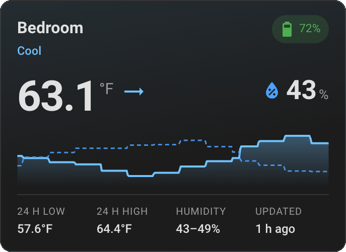

# Shelly H&T Card

A Home Assistant dashboard card for the **Shelly H&T** (Humidity & Temperature) WiFi sensor. It also works with any temperature sensor, with or without humidity and battery.



- **Temperature** in large text, with a **trend arrow** (rising, falling or steady compared with an hour ago).
- **Humidity.**
- **A comfort label:** Cold, Cool, Comfortable, Warm or Hot, plus Dry below 30 % or Humid above 60 %. The card's accent colour follows it.
- **A 24-hour graph** of temperature (solid line) and humidity (dotted line).
- **The 24-hour low and high, and the humidity range.**
- **Battery**, colour-coded like Home Assistant's own battery icons: green from 70 %, orange from 30 %, red below that.
- **When the sensor last reported.** The H&T sleeps between reports to save battery, so an hour or so is normal.
- **History:** tap the temperature, humidity or battery to open its history.

## Install

### Home Assistant Marketplace

[](https://my.home-assistant.io/redirect/hacs_repository/?owner=joeladam518&repository=homeassistant-shelly-ht-card&category=plugin)

1. Open **Marketplace** and search for **Shelly H&T Card**.
2. Install it, then reload the browser.

#### Custom repository

If the card doesn't show up in the search, add it as a custom repository:

1. Open **Marketplace** and choose **⋮ → Custom repositories**.
2. Add `https://github.com/joeladam518/homeassistant-shelly-ht-card` with the type **Dashboard**.
3. Find **Shelly H&T Card** and install it, then reload the browser.

### By hand

1. Download `shelly-ht-card.js` from the [latest release](https://github.com/joeladam518/homeassistant-shelly-ht-card/releases/latest) into `/config/www/`.
2. Go to **Settings → Dashboards → ⋮ → Resources → Add resource**:
   - URL: `/local/shelly-ht-card.js?v=2.1.3`
   - Type: **JavaScript module**
3. Hard-refresh the browser. In the phone app, use **Settings → Companion app → Debugging → Reset frontend cache**.

When you update, change the `?v=` number so browsers load the new file.

## Options

```yaml
type: custom:shelly-ht-card
temperature: sensor.shellyhtg3_temperature # required
name: Bedroom # optional, defaults to the sensor's area
humidity: sensor.shellyhtg3_humidity # optional, found on the same device
battery: sensor.shellyhtg3_battery # optional, found on the same device
```

| Option        | Default   | What it does                                                |
| ------------- | --------- | ----------------------------------------------------------- |
| `temperature` | required  | Temperature sensor, in °C or °F.                            |
| `name`        | area name | Card title. Falls back to the sensor's area, then its name. |
| `humidity`    | auto      | Humidity sensor. The card finds it on the same device.      |
| `battery`     | auto      | Battery sensor. The card finds it on the same device.       |

**Empty graph?** The graph and low/high need the sensors in Home Assistant's long-term statistics. The Shelly integration sets this up already.

## Develop

Needs Node 22+.

```sh
npm install
npm run watch   # rebuild dist/shelly-ht-card.js on every change
npm run check   # typecheck, lint, format check, build, tests (what CI runs)
npm run fmt     # format everything
```

- **Code:** TypeScript + [Preact](https://preactjs.com) function components in `src/` (`.tsx`), styles in `src/*.css` (PostCSS), built with [rolldown](https://rolldown.rs) into one file with Preact included.
- **Shared helpers** come from [`@joeladam518/homeassistant-ui-shared`](https://github.com/joeladam518/homeassistant-ui-shared) on GitHub Packages. To install, put a token with `read:packages` in `~/.npmrc` as `//npm.pkg.github.com/:_authToken=<token>`.
- **Testing in Home Assistant:** copy `dist/shelly-ht-card.js` to `/config/www/` and bump `?v=` on the resource.

**Releasing:** run `npm version <patch|minor|major>`, push with tags, then publish a GitHub release for the new `v…` tag. CI builds the card and attaches `shelly-ht-card.js` to the release, which is what the Marketplace installs.

## License

MIT
